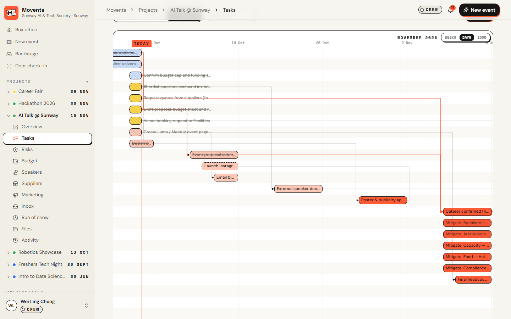
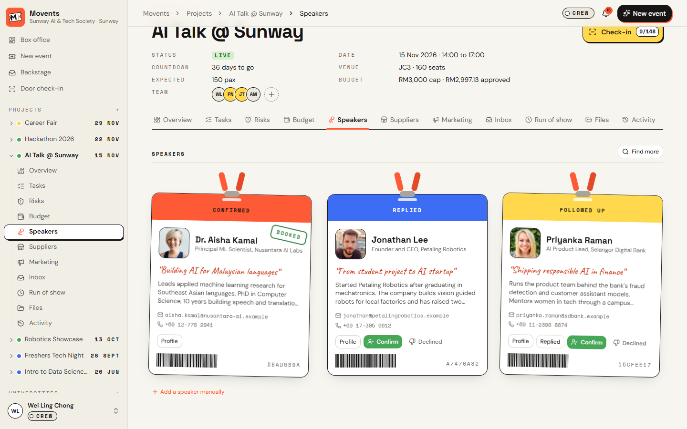
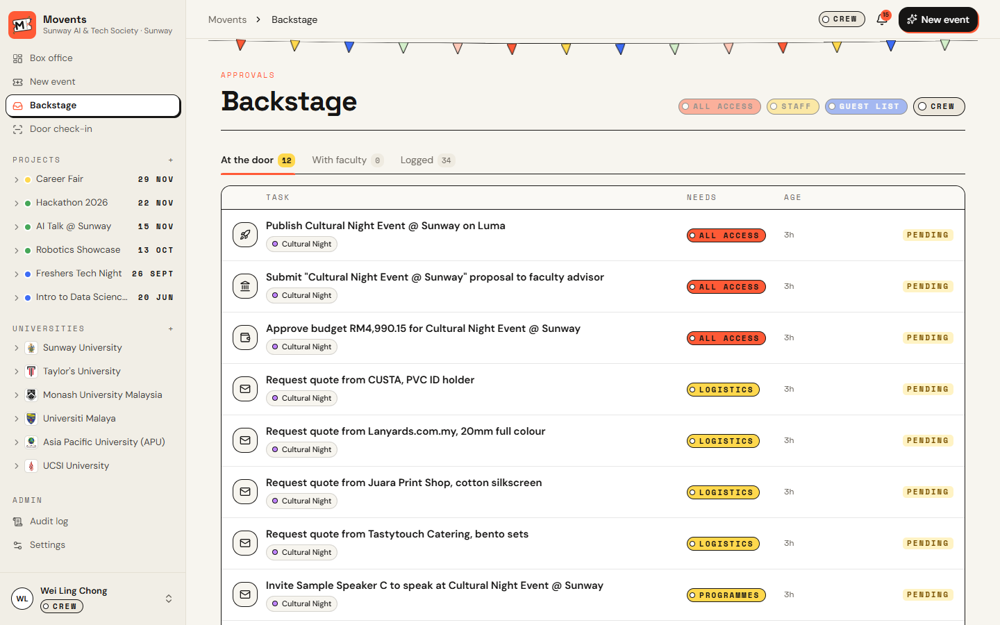
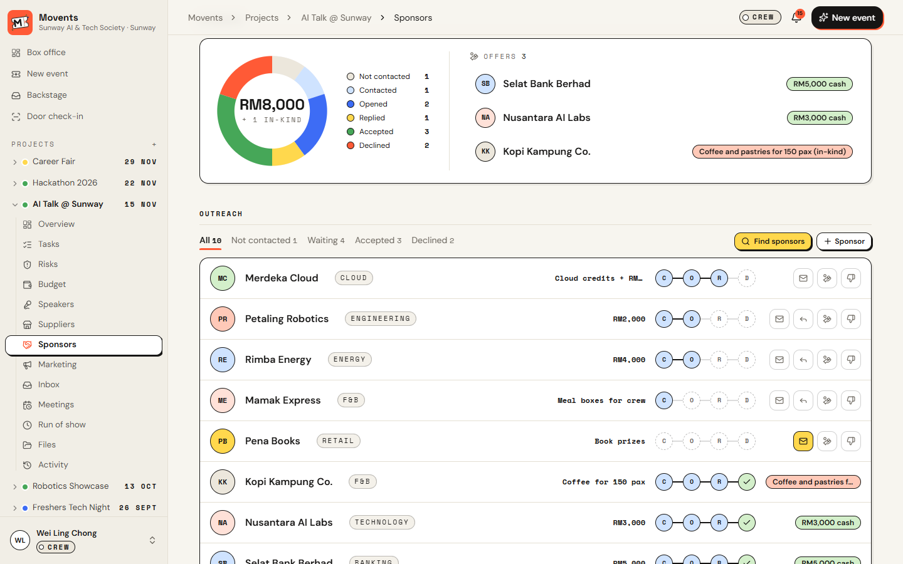

<p align="center">
  
</p>

<h1 align="center">Movents</h1>

<p align="center"><b>Tell your AI assistant the event. Movents plans the rest.</b><br/>
Event planning for university societies: SOP-compliant plans, budgets, approvals and paperwork, driven by any MCP-capable AI assistant.</p>

<p align="center">
  <a href="https://movents.vercel.app"><b>Open Movents</b></a> ·
  <a href="docs/AI_ASSISTANTS.md"><b>Connect your AI</b></a> ·
  <a href="docs/USER_GUIDE.md"><b>User guide</b></a> ·
  <a href="docs/DEPLOYMENT.md"><b>Deploy</b></a>
</p>


## The problem

Student societies run campus events on spreadsheets, chat threads and guesswork. Every university has its own
approval chain, lead times and paperwork, so committees miss deadlines, go over budget and redo the same work every
semester.

## What Movents does

One message to your AI assistant becomes a fully planned event. Give it the idea, date, headcount, budget, who is
helping and any suppliers you want. Through the Movents MCP server it plans everything the way your university's SOP
requires:

1. **Plan:** reads the university SOP and lessons from past events, then works the timeline back from the SOP deadlines, with task dependencies.
2. **Research:** if your assistant can search the web, it finds speakers, supplier quotes and sponsors.
3. **Budget:** composes a budget with contingency and adapts it (cheaper suppliers, then cuts) until it fits the cap.
4. **Draft:** proposal in the SOP's format (PDF and Word), risk register with a weather plan, run of show, crew roster and a marketing kit.
5. **Check:** budget within cap, every SOP section present, lead times met, venue free of clashes.
6. **Act, with approval:** speaker invites, supplier quotes, budget sign-off, faculty submission, event pages. Anything a member is not allowed to do goes to the right approver first, and every action is logged.
7. **Close out:** after the event, the post-event report and lessons learned feed into the next plan.

Works with Claude (claude.ai, desktop, Claude Code), ChatGPT, Cursor and any other MCP client. See
[Connect your AI assistant](docs/AI_ASSISTANTS.md).

## A look inside

| Project overview | Timeline with dependencies |
|---|---|
|  |  |
| **Budget with spend charts** | **Speakers** |
|  |  |
| **Backstage approvals** | **Sponsors** |
|  |  |

## Features

**Workspaces and people**
- Sign in with Google or an emailed one-time link. Each society is a private workspace; invite your committee by email with a role and department. One person can belong to several societies.
- Event teams: only people added to an event can see and edit it (President, VP and faculty advisor see all of their society's events).

**Projects**
- Box office dashboard: countdown, progress, budget and risks for every event, plus your tasks grouped by event.
- Tasks as a list, board or Gantt timeline with dependencies and the critical path.
- Risks: 5x5 heat map and register with mitigation tasks. Budget with spend alerts and one-click supplier swaps.
- Speakers, suppliers (quotes, contracts, deposits), sponsors (outreach with the proposal attached, replies, offers).
- Meetings with agenda, minutes, decisions and action items that become tasks.
- Registration page with waitlist and QR door check-in; optional Luma and Meetup publishing and sync.
- Marketing kit: poster and social images with captions; your assistant can generate the images.
- Generated files: proposal, budget sheet, risk register, run sheet, calendar feed, post-event report.

**Universities**
- SOP library with the approval chain, lead times, templates and budget rules. Upload your university's SOP and Movents applies its structure.
- Venues with a booking calendar, and a shared supplier registry.

**Governance**
- Role-based approvals (Backstage), faculty approval by signed link, and a full audit log.

## Roles

| Role | Can do without approval |
|---|---|
| President / VP | Everything; manage members |
| Director | Speaker and supplier emails, approvals for their own department, budget up to the SOP limit |
| Committee member | Drafts, plans and internal calendar. Everything outbound goes to Backstage for approval |
| Faculty advisor | Approves or rejects the proposal from the emailed link |

Your AI assistant acts as you, with exactly these permissions.

## Run locally

```bash
npm install
cp .env.example .env.local   # optional; everything works without keys
npm run dev
```

Open http://localhost:3000 and sign in with any email: without an email provider the sign-in link is printed in the
terminal. Without `DATABASE_URL` the app uses an embedded Postgres (PGlite) under `.data/`.

## Architecture

- **Next.js 15** (App Router, server actions, route handlers), React 19, Tailwind CSS 4.
- **Postgres** through `postgres` (Neon, Supabase, RDS…), PGlite for local development and tests.
  Versioned migrations in `src/lib/migrations`, applied automatically under an advisory lock or with `npm run migrate`.
- **Auth:** opaque, hashed session cookies; Google OAuth and one-time email links; hashed personal API tokens;
  an OAuth 2.1 authorization server (PKCE, dynamic client registration) for MCP clients.
- **Tenancy:** every query is scoped to the society; event access is checked on every page, action, API route and MCP tool.
- **MCP:** Streamable HTTP at `/api/mcp` with validated tool arguments and tool annotations. The same tools are
  available over REST at `/api/agent/tools/<name>` ([OpenAPI](https://movents.vercel.app/api/openapi.json)).
- **Documents:** `docx`, `pdf-lib`, `exceljs`, rendered on request from live data.

## Security

Security headers (CSP, HSTS, frame blocking), CSRF origin checks, rate limits on sign-in, public forms and MCP,
signed expiring links for anything shared outside the app, type-checked and size-capped uploads, SSRF-safe media
fetching, and errors logged server-side without leaking internals. Report vulnerabilities privately to the maintainers.

## Tests

```bash
npm run lint && npm run typecheck && npm test
```

Covers the planning engine and budget loop, lead times, venue clashes, roles, SOP parsing, tenant isolation,
invites, OAuth (PKCE, rotation), signed links, argument validation, media checks and database behaviour.
CI runs them against Postgres on every push.

## Deploy

See [docs/DEPLOYMENT.md](docs/DEPLOYMENT.md). In short: Vercel + any Postgres, set `DATABASE_URL`, `APP_SECRET`,
`APP_URL`, `CRON_SECRET` and an email provider.

---

Movents started as a [Dormathon 2026](docs/HACKATHON.md) entry.
