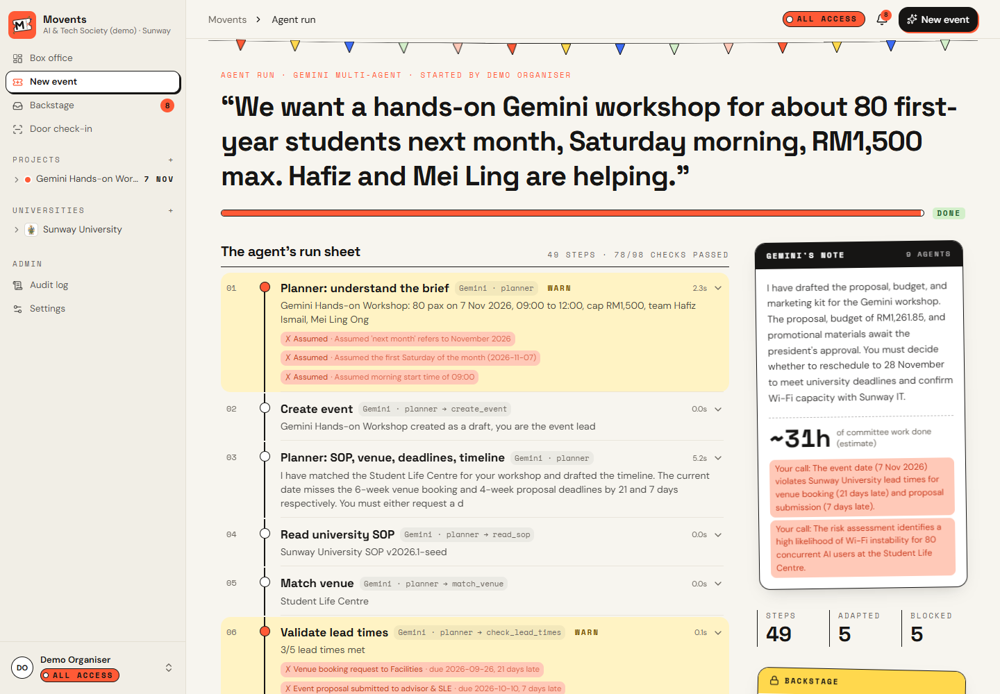
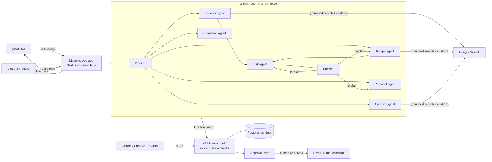

<p align="center">
  
</p>

<h1 align="center">Movents</h1>

<p align="center"><b>One prompt in. A full, SOP-checked event pack out.</b><br/>
A team of Gemini agents that plans university society events for volunteer committees.</p>

<p align="center">
  <a href="https://movents-743449161087.asia-southeast1.run.app"><b>Open the live app</b></a> ·
  <a href="#try-it-in-2-minutes"><b>Try it in 2 minutes</b></a> ·
  <a href="#architecture"><b>Architecture</b></a> ·
  <a href="docs/DEPLOYMENT.md"><b>Deploy</b></a>
</p>

> Google Cloud AI Builder Cup 2026 · Theme 5: Future of Work & Enterprise Productivity



## The problem

Student societies are run by volunteers with full course loads. Every event means the same unpaid admin: read the
university's SOP, back-plan deadlines, find speakers, collect supplier quotes, build a budget under a cap, write a
risk register, draft a proposal in the right format, then chase approvals. We estimate about 25 to 30 hours of
committee time per event (see [Time saved](#time-saved)). Deadlines still get missed, budgets still overrun, and the
same work is redone every semester.

## What Movents does

Type the event the way you would say it:

> "We want a hands-on Gemini workshop for about 80 first-years next month, Saturday morning, RM1,500 max. Hafiz and Mei Ling are helping."

A team of Gemini agents then plans it inside Movents, and you watch every step live:

1. **Planner** reads the brief (relative dates like "next month" included), creates the event, reads the university
   SOP, books a free venue, checks SOP lead times and back-plans the timeline.
2. **Specialist agents work in parallel:**
   - **Speaker agent:** real speakers from Google Search, each with a source link.
   - **Budget agent:** real supplier prices from Google Search, then a budget with 10% contingency, adapted until it fits the cap.
   - **Sponsor agent:** likely local sponsors, with sources.
   - **Proposal agent:** event-specific objectives, learning outcomes and audience, in the SOP's format.
   - **Promotion agent:** poster and social captions in a student voice.
   - **Risk agent** (after speakers and budget): risk register, run of show, roster, plus risks specific to this event.
3. **Checker** runs the hard SOP checks (budget within cap, every proposal section present, lead times), then a
   Gemini review for consistency and quality, like a strict faculty advisor.
4. **Re-plan:** anything fixable goes back to the agent that owns it, with the problem attached. Decisions only a
   human can make (like moving the date) are listed for the organiser.
5. **Approvals:** speaker invites, supplier quote requests, budget sign-off, faculty submission and event pages are
   drafted and **queued for a human**. The AI never sends or publishes on its own, whatever the user's role.

You walk out with the Event Pack: proposal (PDF and Word), budget (Excel and CSV), risk register, run sheet,
timeline (calendar file) and marketing kit.

**A real run on the live site:** the checker found the catering covered 119 people, not the 150 expected, and sent
it back to the budget agent. On the next round it caught the risk register still saying 119, and the risk agent
fixed that too. It also flagged a missed venue-booking deadline for the organiser to decide on. The whole run took
about 2 to 3 minutes and ended with 8 actions waiting for approval.

## Why you can trust the output

- **No invented people or prices.** Research runs in two steps: a Gemini answer grounded in Google Search, then a
  JSON extraction of that answer. Each person, supplier or sponsor is kept only if Google's citations back it, and
  its link is that citation. Anything else is dropped, and the trace says so.
- **Human in the loop.** Every outbound action passes one approval gate (`src/lib/actions.ts`). Approvals are
  role-based (President, VP, Directors), and everything is audit-logged.
- **Same permissions as the user.** Agents call the same tools as the app, with the same society isolation and
  event-team checks. An agent cannot touch an event its user cannot.
- **It degrades, it does not break.** Busy model: the next model takes over. Gemini down: the rule-based planner
  finishes the run. No search: clearly marked samples, never made-up names.

## Time saved

The run's final note adds up the work the agents did, using our estimates of what a committee spends doing each
piece by hand:

| Work | Hours by hand (estimate) |
|---|---|
| Proposal in SOP format | 5 |
| Speaker research | 3 |
| Supplier prices | 3 |
| Budget build and check | 3 |
| Marketing kit | 2.5 |
| Timeline, risk register, run sheet and roster, sponsors | 2 each |
| SOP reading, proofreading against the SOP, approval and outreach emails | 1.5 each |
| Brief and set-up, venue | 1 each |

A typical plan comes to about 25 to 31 hours. These are estimates, not measurements
(`src/lib/agent/gemini/brief.ts`).

## Architecture



- **One tool registry, two front doors.** The same 49 tools power the in-app Gemini agents (function calling) and
  the MCP server at `/api/mcp` for outside assistants.
- **Agent loop** (`src/lib/agent/gemini/loop.ts`): Gemini picks a tool, Movents checks membership and role, runs it,
  and sends the result back, until Gemini answers in text. Tool errors go back to the model so it can correct itself.
- **Live trace:** every step, check and adaptation is written to the run as it happens; `/runs/:id` polls it.
- **Stack:** Next.js 15 (App Router), React 19, Tailwind CSS 4, Postgres through `postgres` (PGlite for local
  development and tests), `docx`, `pdf-lib` and `exceljs` for the documents.

## Google Cloud and Gemini

| Service | Used for |
|---|---|
| **Vertex AI: Gemini** (gemini-3-flash-preview, falling back to 3.5-flash-lite and 3.5-flash) | Planner, six specialist agents, checker and summary: function calling and JSON output |
| **Grounding with Google Search** | Real speakers, supplier prices and sponsors, with citations |
| **Cloud Run** (asia-southeast1) | The app, with CPU always on so agent runs continue after the request returns |
| **Cloud Build + Artifact Registry** | Builds the container from source |
| **Secret Manager** | Database URL, app secret and cron secret |
| **Cloud Scheduler** | Daily automations: speaker follow-ups, reminders, spend alerts |
| **Cloud Logging** | Gemini retries and errors |
| **IAM** | A dedicated service account; Vertex AI access without API keys |

Data lives in Postgres on Neon (free tier, Singapore).

## Try it in 2 minutes

1. Open https://movents-743449161087.asia-southeast1.run.app
2. Click **Try the live demo**. You get a private sandbox society with sample teammates, signed in as its President.
   No email is ever sent from the demo.
3. On **New event**, click a suggestion or type your own brief, then **Plan with Gemini**.
4. Watch the run sheet fill in. When it is done, open the files under "You walk out with" and the **Backstage**
   approval queue.

## A look inside

| Project overview | Timeline with dependencies |
|---|---|
|  |  |
| **Budget with spend charts** | **Speakers** |
|  |  |
| **Backstage approvals** | **Sponsors** |
|  |  |

Beyond the planner, Movents is a full society workspace: tasks (list, board, Gantt), risk heat map, supplier
contracts and deposits, sponsor outreach, meetings with minutes, registration with QR check-in, a venue calendar,
an SOP library per university and a full audit log. See the [user guide](docs/USER_GUIDE.md).

## Roles

| Role | Can do without approval |
|---|---|
| President / VP | Everything; manage members |
| Director | Speaker and supplier emails, approvals for their own department, budget up to the SOP limit |
| Committee member | Drafts, plans and internal calendar. Everything outbound goes to Backstage for approval |
| Faculty advisor | Approves or rejects the proposal from the emailed link |

The Gemini agents act as the signed-in user with these permissions, and always queue outbound actions for a human.

## Run it yourself

```bash
npm ci
npm run dev        # http://localhost:3000, local Postgres (PGlite) in .data/
```

Create `.env.local` with `GEMINI_API_KEY=...` (Gemini API) and `DEMO_MODE=1`. To use Vertex AI instead, set
`GEMINI_PROVIDER=vertex` and `GOOGLE_CLOUD_PROJECT`. Without an email provider, sign-in links print to the terminal.

```bash
npm run typecheck && npm run lint && npm test && npm run build
```

**Deploy to Cloud Run** (needs gcloud and billing on the project; it builds the container, stores secrets and
schedules the daily job):

```bash
DATABASE_URL='postgresql://...' bash scripts/deploy-cloudrun.sh
```

Details in [docs/DEPLOYMENT.md](docs/DEPLOYMENT.md).

## Where things are

| Path | What |
|---|---|
| `src/lib/agent/gemini/` | Orchestrator, agent loop, grounded research, brief parsing |
| `src/lib/ai/gemini.ts` | Gemini client: Vertex AI or API key, model fallback, retries |
| `src/lib/agent/registry.ts` | The 49 tools, shared by the Gemini agents and MCP |
| `src/lib/actions.ts` | The approval gate for every outbound action |
| `src/lib/planning.ts` | Deterministic planning: timeline, venue, budget, risks |
| `tests/` | 61 tests, including the agent loop, citations and the approval gate |

## Security

Security headers (CSP, HSTS, frame blocking), CSRF origin checks, rate limits on sign-in, public forms, agent runs
and MCP, signed expiring links for anything shared outside the app, tenant isolation on every query, type-checked
and size-capped uploads, and errors logged server-side without leaking internals.

## Team

_To be added._

---

Movents started as a [Dormathon 2026](docs/HACKATHON.md) entry and was rebuilt around Gemini on Google Cloud for the
AI Builder Cup 2026.
